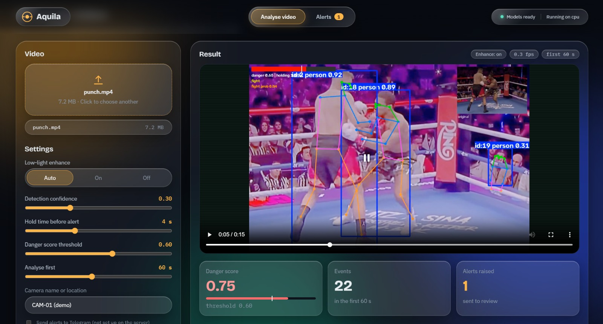
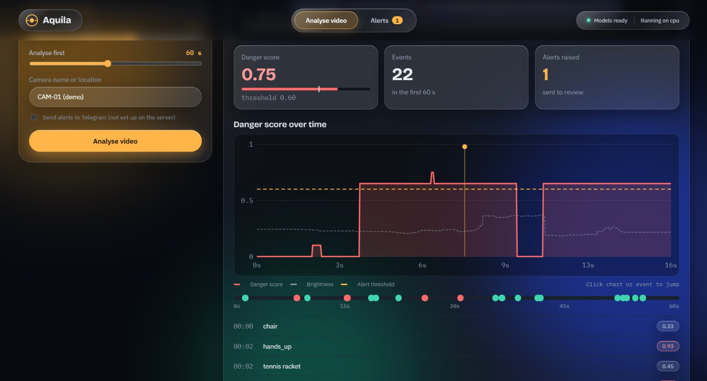
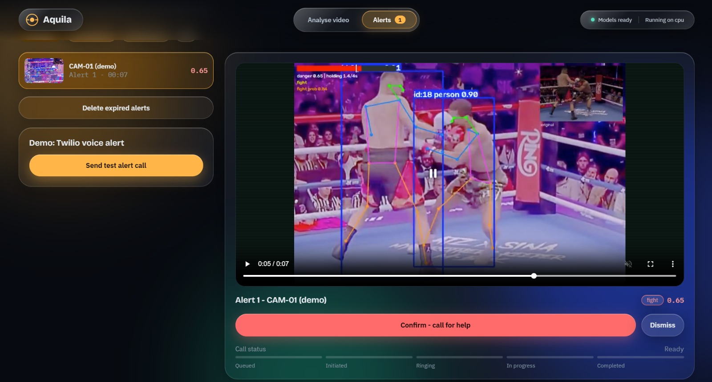

# Aquila

**Aquila** is a low-light early-warning video analysis system. It combines a **FastAPI backend** and a **React (Vite) frontend** to analyze surveillance-style video, run detection/pose/fight-related inference, produce annotated output, and manage alerts with human review.

> **Security note:** Real secrets (API keys, Twilio/Telegram credentials) belong in local `.env` files. This repository includes **`.env.example` templates only** — no `.env` secrets are committed.

## Dashboard / Screenshots

| View | Preview |
|---|---|
| Dashboard |  |
| Dashboard (alternate view) |  |
| Alerts |  |

## Features

- **Video analysis jobs** — upload a video and receive progress + results (annotated video, events, score series).
- **Low-light enhancement options** — configurable enhancement mode (`auto` / `on` / `off`).
- **Alerts workflow** — list alerts, confirm/dismiss, and optional notifications (Telegram / Twilio, when configured).
- **Human-in-the-loop review** — confirm or dismiss alerts before escalation actions.
- **Single or split server modes** — dev mode (Vite + API) or production-style build served by FastAPI.
- **API key protection (optional)** — set `AQUILA_API_KEY` to require an access key.

## Project Structure

```text
aquila-project/
├── backend/                 # FastAPI app, pipeline, models, DB, notifications
│   ├── main.py              # API entrypoint (uvicorn main:app)
│   ├── pipeline.py          # Video analysis pipeline
│   ├── config.py            # Configuration / thresholds / retention
│   ├── fight.py             # Fight-detection helpers (model bundle)
│   ├── aquila_fight_clf.joblib
│   ├── requirements.txt
│   └── .env.example
├── frontend/                # React + Vite UI
│   ├── src/
│   ├── package.json
│   └── vite.config.js
├── docs/
│   └── screenshots/         # Put README/dashboard screenshots here
├── .env.example
├── setup.sh
├── run_dev.sh
└── run_prod.sh
```

## Requirements

- **Python** 3.10+
- **Node.js** 18+
- **ffmpeg** (recommended/used by media workflows)
- **git**
- **NVIDIA GPU** strongly recommended for practical performance (YOLO/pose/enhancement workloads can be slow on CPU)

## Setup

### 1) Clone and configure environment variables

```bash
git clone https://github.com/Ritesh2800/aquila-project.git
cd aquila-project
```

Create local env files from templates (edit values as needed):

```bash
# macOS/Linux
cp .env.example .env
cp backend/.env.example backend/.env
```

```powershell
# Windows PowerShell
Copy-Item .env.example .env
Copy-Item backend\.env.example backend\.env
```

Fill in only what you need (e.g., `AQUILA_API_KEY`, Telegram, Twilio). **Do not commit `.env` files.**

### 2) Install dependencies

**macOS/Linux (scripted):**

```bash
./setup.sh
```

**Windows (manual, typical):**

```powershell
# From repo root
python -m venv .venv
.\.venv\Scripts\Activate.ps1
pip install -r backend\requirements.txt

# Frontend
cd frontend
npm install
cd ..
```

> `setup.sh` also clones `Zero-DCE_extension` if missing. On Windows, clone it manually if your workflow needs it:
> `git clone https://github.com/Li-Chongyi/Zero-DCE_extension.git`

## Run

### Development (API + Vite dev server)

- **API:** `http://localhost:8000`
- **Frontend:** `http://localhost:5173` (open this in dev mode)

**macOS/Linux:**

```bash
./run_dev.sh
```

**Windows (two terminals):**

```powershell
# Terminal 1 (backend)
.\.venv\Scripts\Activate.ps1
cd backend
uvicorn main:app --reload --port 8000
```

```powershell
# Terminal 2 (frontend)
cd frontend
npm run dev
```

The first start may download model weights (e.g., YOLO weights). The UI/sidebar should indicate when models are ready.

### Production-style (build frontend, serve from FastAPI)

```bash
./run_prod.sh
# then open http://localhost:8000
```

On Windows, build the frontend (`npm run build` in `frontend/`) and run `uvicorn main:app --host 0.0.0.0 --port 8000` from `backend/` (with the venv activated).

## Environment Variables

See [`.env.example`](.env.example) and [`backend/.env.example`](backend/.env.example). Common settings:

| Variable | Purpose |
|---|---|
| `AQUILA_API_KEY` | Enables API/login protection. **Set this before exposing the server beyond your own machine.** |
| `AQUILA_MAX_UPLOAD_MB` | Upload size limit (default 500) |
| `AQUILA_CORS` | Allowed CORS origin(s), e.g. `http://localhost:5173` |
| `AQUILA_CAMERA` | Camera/demo label |
| `AQUILA_OBJ_WEIGHTS`, `AQUILA_POSE_WEIGHTS` | YOLO object/pose weight paths |
| `TWILIO_SID`, `TWILIO_TOKEN`, `TWILIO_FROM`, `TWILIO_TO` | Twilio voice/SMS integration (if used) |
| `TELEGRAM_TOKEN`, `TELEGRAM_CHAT_ID` | Telegram alerts (optional) |

Scoring weights, thresholds, and retention settings are primarily in `backend/config.py`.

## API Overview

| Endpoint | Purpose |
|---|---|
| `GET /api/health` | Device, model status, auth/ffmpeg/notification availability |
| `POST /api/analyze` | Upload a video and settings; returns a job |
| `GET /api/jobs/{id}` | Job progress/result (video URL, events, score series) |
| `GET /api/alerts` | List alerts (`?status=pending`) |
| `GET /api/alerts/{id}` | Get a single alert |
| `POST /api/alerts/{id}/confirm` | Confirm an alert (human review) |
| `POST /api/alerts/{id}/dismiss` | Dismiss an alert |
| `POST /api/cleanup` | Delete expired alerts |
| `POST /api/test-call` | Demo Twilio call (if configured) |
| `GET /api/call-status/{call_sid}` | Poll Twilio call status (if configured) |
| `GET /files/{kind}/{name}` | Serve output/alert media |

Interactive docs (when running locally): `http://localhost:8000/docs`

## How to add screenshots to this README (so they appear on GitHub)

1. **Put image files in the repo** (recommended):
   - Create/use the folder: `docs/screenshots/`
   - Copy your screenshots there, for example:
     - `docs/screenshots/dashboard.png`
     - `docs/screenshots/analysis.png`
     - `docs/screenshots/alerts.png`
2. **Reference them in `README.md`** using relative paths:
   ```md
   
   ```
3. **Commit and push**:
   ```bash
   git add docs/screenshots README.md
   git commit -m "Add dashboard screenshots to README"
   git push
   ```
   GitHub renders the images automatically.

**Alternative (GitHub web UI):** open the repository on GitHub, edit `README.md`, and drag-and-drop images into the editor. GitHub uploads them and inserts image URLs. This is quick, but storing screenshots in `docs/screenshots/` keeps them versioned with the project.

## Operational Notes

- Videos are analyzed **one at a time** (shared tracker/model state; queued execution).
- Uploaded originals may be removed after analysis; annotated outputs/alert clips are retained according to cleanup/retention behavior.
- Do not expose the server publicly without setting `AQUILA_API_KEY` and reviewing CORS/network settings.
- Colab/ngrok can be used for temporary demos, but it is not a production deployment setup.

## License / Status

Internal/project repository. Add a `LICENSE` file if you intend to open-source it.
